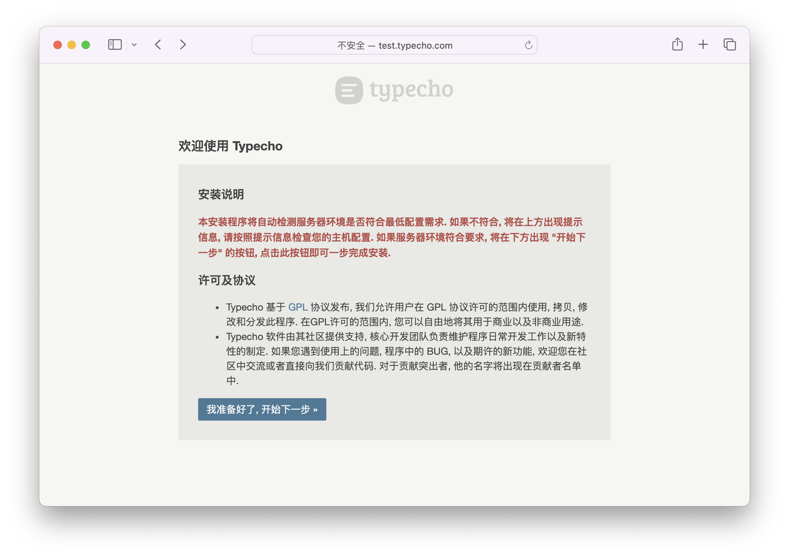

import Tabs from '@theme/Tabs';
import TabItem from '@theme/TabItem';

# 安装

本页介绍如何下载 Typecho 并通过浏览器完成安装。开始之前，请先确认服务器满足[环境要求](./requirements.md)。如果要在容器、CI 或脚本里安装，请看[命令行与无人值守安装](./cli-install.md)。

## 1. 获取安装包

后台页脚的“资源下载”链接指向官方下载页。安装包有两个来源，内容相同：

| 来源 | 地址 |
|---|---|
| 官方下载页 | [typecho.org/download](https://typecho.org/download) |
| GitHub Releases | [github.com/typecho/typecho/releases](https://github.com/typecho/typecho/releases)，附件名为 `typecho.zip` |

在服务器上可以直接下载最新正式版并解压到网站根目录（下文以 `/srv/www/typecho` 为例）：

```bash
wget https://github.com/typecho/typecho/releases/latest/download/typecho.zip
unzip typecho.zip -d /srv/www/typecho
```

`typecho.zip` 解压后直接就是程序文件，没有外层目录：

```text
admin/        后台
install/      安装程序用到的建表脚本与表单
usr/          主题、插件、上传文件（uploads）
var/          程序核心
index.php     入口
install.php   安装程序
```

:::caution
请下载 Releases 中的正式版。`master` 分支包含尚未发布的改动，不适合用于生产站点。
:::

## 2. 准备数据库

| 数据库 | 需要事先准备什么 |
|---|---|
| MySQL / MariaDB | 手动创建一个空数据库，以及能访问它的用户 |
| PostgreSQL | 手动创建一个空数据库，以及能访问它的用户 |
| SQLite | 不需要，安装程序会自动创建数据库文件 |

安装程序只负责建表，不会建库。数据库不存在时，第二步会提示 **“数据库: "xxx"不存在，请手动创建后重试”**。

<Tabs groupId="database">
  <TabItem value="mysql" label="MySQL / MariaDB" default>

```sql
CREATE DATABASE typecho DEFAULT CHARACTER SET utf8mb4;
CREATE USER 'typecho'@'localhost' IDENTIFIED BY '请换成你的密码';
GRANT ALL PRIVILEGES ON typecho.* TO 'typecho'@'localhost';
```

  </TabItem>
  <TabItem value="pgsql" label="PostgreSQL">

```sql
CREATE USER typecho WITH PASSWORD '请换成你的密码';
CREATE DATABASE typecho OWNER typecho ENCODING 'UTF8';
```

  </TabItem>
</Tabs>

## 3. 运行 Web 安装程序

在浏览器中打开 `https://你的域名/install.php`。安装程序分三步，地址栏里的 `?step=` 参数表示当前步骤：

| 步骤 | 地址 | 内容 |
|---|---|---|
| 1 | `install.php`（或 `?step=1`） | 欢迎页、许可协议、界面语言；点击后检查环境 |
| 2 | `install.php?step=2` | 选择数据库适配器并填写连接信息，写入配置文件并建表 |
| 3 | `install.php?step=3` | 创建管理员帐号，写入初始数据 |

步骤之间有检查：数据表还没建好时访问 `?step=3` 会被送回 `?step=2`；数据表已经存在时访问 `?step=2` 会被送到 `?step=3`。全部完成后再访问 `install.php`，会直接跳转到网站首页。

### 第一步：欢迎与环境检查



如果安装包里有多个语言包，右下角会出现语言下拉框，可在这里切换安装界面语言。点击 <kbd>我准备好了, 开始下一步 »</kbd> 后，安装程序会检查 PHP 扩展和 `usr/uploads` 目录权限（见[环境要求](./requirements.md)），通过后进入第二步。

### 第二步：数据库配置

先在“数据库适配器”下拉框里选择适配器，表单会随之切换成对应数据库的字段。

| 字段 | MySQL 默认值 | PostgreSQL 默认值 | 说明 |
|---|---|---|---|
| 数据库前缀 | `typecho_` | `typecho_` | 1–16 位字母、数字、下划线或连字符 |
| 数据库地址 | `localhost` | `localhost` | MySQL 可填 socket 路径，见下文 |
| 数据库端口 | `3306` | `5432` | 在“高级选项”中 |
| 数据库用户名 | 空（提示 `root`） | `postgres` | 必填 |
| 数据库密码 / 数据库名 | — | — | 数据库名必填，密码可为空 |
| 数据库编码 | `utf8mb4`（可选 `utf8`） | 固定为 `utf8`，不显示 | MySQL 在“高级选项”中 |
| 数据库引擎 | `InnoDB`（可选 `MyISAM`） | — | 仅 MySQL |
| 数据库 SSL 证书 | 空 | — | CA 证书路径，仅 MySQL |
| 启用 SSL 服务端证书验证 | 不启用 | 不启用 | MySQL：填写了 CA 证书时自动启用验证；PostgreSQL：启用后以 `sslmode=require` 连接 |

SQLite 只有一个“数据库文件路径”字段，默认在 `usr/` 目录下生成一个随机文件名的 `.db` 文件。

#### 使用 MySQL socket

如果 MySQL 只监听 Unix socket，把“数据库地址”填成 socket 文件的路径即可，例如：

```text
/var/run/mysqld/mysqld.sock
```

只要地址里含有 `/`，安装程序就会把它当作 socket 路径：端口被忽略，`Pdo_Mysql` 和 `Mysqli` 两个适配器都会通过 socket 连接。

#### 数据表已存在、配置文件写不进去时

安装程序用一个隐藏字段 `dbNext` 决定遇到这些情况时怎么办。点击 <kbd>确认, 开始安装 »</kbd> 时它的值是 `none`；出现下面的提示后，你点的按钮会把它改成别的值并重新提交：

| `dbNext` | 何时出现 | 效果 |
|---|---|---|
| `none` | 默认 | 正常安装；如果同前缀的数据表已存在，提示“安装程序检查到原有数据表已经存在.”并给出下面两个按钮 |
| `delete` | 点击“删除原有数据” | 删除同前缀的 7 张表后重新建表 |
| `keep` | 点击“使用原有数据” | 保留原有表；原有数据完整时直接结束安装，用户名和密码与原来一致；表在但数据不完整时进入第三步 |
| `config` | 点击“创建完毕, 继续安装 »” | 跳过写配置文件，改为读取你手动创建的 `config.inc.php` |

:::danger
“删除原有数据”会删除 `comments`、`contents`、`fields`、`metas`、`options`、`relationships`、`users` 这 7 张表（带你填写的前缀），无法撤销。
:::

**无法写入配置文件**：如果网站根目录不可写，安装程序会提示“安装程序无法自动创建 config.inc.php 文件”，并在下方给出完整的配置文件内容。把它复制到网站根目录下新建的 `config.inc.php` 中，再点击 <kbd>创建完毕, 继续安装 »</kbd>。如果此时文件仍不存在，会提示“没有检测到您手动创建的配置文件, 请检查后再次创建”。

### 第三步：创建管理员帐号

| 字段 | 说明 |
|---|---|
| 网站地址 | 程序自动识别，不正确时手动修改 |
| 用户名 | 必填，不超过 32 个字符 |
| 登录密码 | 留空时随机生成 8 位密码 |
| 邮件地址 | 必填，不超过 200 个字符 |

点击 <kbd>继续安装 »</kbd> 后，页面会显示用户名和密码，以及进入控制面板和查看网站的链接。**如果密码是随机生成的，请立即记下来**，这个页面关闭后无法再次查看。

安装程序还会创建一个默认分类、一篇文章“欢迎使用 Typecho”、一个独立页面“关于”和一条评论，可以在后台随意修改或删除。

## 安装之后

- **登录地址**：后台位于 `https://你的域名/admin/`。
- **地址重写**：安装过程不依赖地址重写（伪静态）。登录后台或打开文章时出现 404，通常是 Web 服务器没有把 `/index.php/...` 形式的请求交给 PHP 处理。nginx、Apache、Caddy 的具体配置写在“部署与运维”章节的 Web 服务器配置页里，该页尚未发布。
- **配置文件**：`config.inc.php` 保存了数据库连接信息，请勿公开。

## 安装后丢失管理员密码

Typecho 没有“找回密码”功能。按下面的顺序处理：

1. **请其他管理员重置**：如果站点还有别的管理员，可以在后台“管理 → 用户”中编辑你的帐号并设置新密码。
2. **直接改数据库**：登录时，如果数据库里保存的密码既不是 `$P$` 开头也不是 `$T$` 开头，Typecho 会把它当作 MD5 值比较。因此可以把密码字段改成新密码的 MD5，登录后再到“个人设置”里重新设置一次密码，让它以更安全的方式保存。

先算出新密码的 MD5：

```bash
php -r 'echo md5("新密码"), PHP_EOL;'
```

再用数据库工具执行（表前缀按实际修改，`uid = 1` 是安装时创建的管理员）：

```sql
UPDATE typecho_users SET password = '上一步得到的 32 位 MD5' WHERE uid = 1;
```

不记得用户名时，可以先查出所有管理员（`group` 是保留字，MySQL 用反引号，PostgreSQL 和 SQLite 用双引号）：

```sql
-- MySQL
SELECT uid, name, mail FROM typecho_users WHERE `group` = 'administrator';
-- PostgreSQL / SQLite
SELECT uid, name, mail FROM typecho_users WHERE "group" = 'administrator';
```

:::tip
如果站点还是空的，也可以删除 `config.inc.php` 和数据表后重新安装。已有内容时不要这样做。
:::
