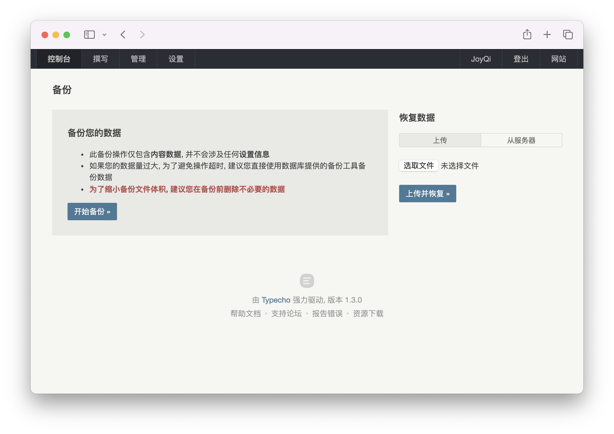

# Backup and Restore

Back up before upgrading, migrating, switching servers or changing data in bulk. A Typecho site consists of three parts, and **a complete backup contains all three**:

| Part | Contents | How to back it up |
|---|---|---|
| Database | Posts, pages, comments, categories and tags, users, and **all settings** (site settings, current theme, enabled plugins and their configuration, permalink rules) | The database's own export tool (recommended), or the admin "Backup" feature (content only, see below) |
| `usr/` directory | Themes, plugins, language packs, **uploaded attachments**; with SQLite, the database file is also here by default | Archive the files |
| `config.inc.php` | Database connection and custom constants | Copy the file |

:::caution The `usr/` directory needs backing up too
Upgrades do not overwrite `usr/`, but that does not mean you can skip backing it up: the admin "Backup" feature **contains no files at all**, and attachments, themes and plugins exist only in `usr/`; with SQLite, the whole database is in `usr/` as well. Before upgrading or migrating, back up `usr/` together with the database, as the [Upgrade](/guide/getting-started/upgrade) page requires.
:::

## The admin "Backup" feature {#builtin}

Since version 1.1, Typecho has built-in backup and restore, so no backup plugin is needed. It is under "Dashboard → Backup" (控制台 → 备份) in the admin panel (`admin/backup.php`), and **only administrators** can use it.



### What is included and what is not

The page says: "此备份操作仅包含**内容数据**, 并不会涉及任何**设置信息**" (this backup includes only **content data** and does not cover any **settings**). According to `var/Widget/Backup.php`, the backup file contains these 6 tables:

| Table | Contents |
|---|---|
| `contents` | Posts, pages, attachment records, drafts and revisions |
| `comments` | Comments, trackbacks |
| `metas` | Categories, tags |
| `relationships` | Relations between content and categories/tags |
| `users` | Users (including password hashes) |
| `fields` | Custom fields |

**Not included**:

- The `options` table, that is, all settings: site name and URL, reading and discussion settings, permalink rules, the current theme and its settings, which plugins are enabled and their settings;
- Any files: the attachments themselves, themes, plugins;
- Tables created by third-party plugins. A plugin can write its own data into the backup file through the `export` / `import` interfaces of `Widget\Backup`; whether it does so depends on the plugin.

### Export

Click <kbd>开始备份 »</kbd> (Start backup) and the browser downloads a `.dat` file named like `20261016_blog.example.com_6ad1dbcfc14a1.dat` (date, site domain, random string). This is Typecho's own binary format, with a `%TYPECHO_BACKUP_0001%` marker at both the start and the end of the file. It can only be imported with Typecho's "Restore data" feature, not with database tools.

With a large amount of data the export may time out; the page itself suggests "直接使用数据库提供的备份工具备份数据" (back up the data directly with the backup tools provided by the database) in that case.

### Restore

"Restore data" (恢复数据) on the right side of the admin "Backup" page offers two methods:

| Method | How | When to use |
|---|---|---|
| Upload | Choose a local `.dat` file and click <kbd>上传并恢复 »</kbd> (Upload and restore) | When the file is small. Size is limited by PHP's `upload_max_filesize` and `post_max_size` |
| From the server | Put the `.dat` file in the backup directory on the server, select it in the drop-down and click <kbd>选择并恢复 »</kbd> (Select and restore) | When the file is large or uploads are restricted |

The backup directory defaults to `usr/backups` (create it yourself if it does not exist). You can change it to another absolute path with the `__TYPECHO_BACKUP_DIR__` constant; the hint on the page, "将备份文件手动上传至服务器的 … 目录下后, 这里会出现文件选项" (after you manually upload backup files to the … directory on the server, they appear as options here), shows the actual path. Only files with the `.dat` extension appear in the list.

```php title="config.inc.php"
define('__TYPECHO_BACKUP_DIR__', '/data/typecho-backups');
```

:::danger Restoring wipes existing content
The confirmation dialog says "恢复操作将清除所有现有数据" (the restore will clear all existing data): for every table that appears in the backup file, Typecho first **empties** that table and then writes the data from the backup. Export your current data before restoring.
:::

During a restore, Typecho also:

- Logs the current browser in again as the first administrator account in the backup (because the `users` table has been replaced), so after the restore you may be a different administrator;
- Resets the auto-increment sequences of the tables on PostgreSQL;
- Shows "数据恢复完成" (data restore complete) on success.

Because settings are not in the backup, after restoring a backup to a **freshly installed** site you still need to set up the site information, permalinks, theme and plugins again.

A restore only brings back the content in the backup: posts deleted after the backup come back, but site settings changed after the backup (for example the site name) keep their changed values and are not reverted.

## Database-level backup {#database}

To back up **all data** (including settings and plugins' own tables), use the database's own tools. In the commands below, replace the user name and database name with the values from `config.inc.php`.

**MySQL / MariaDB**:

```bash
# 导出（会提示输入密码）
mysqldump --single-transaction --default-character-set=utf8mb4 \
  -u typecho -p typecho > typecho-$(date +%Y%m%d).sql

# 导入到一个已创建的空库
mysql --default-character-set=utf8mb4 -u typecho -p typecho < typecho-20261016.sql
```

Don't put the password directly in a command-line argument (such as `--password=...`); it would appear in the shell history and the process list. If you need it in a script, put the password in `~/.my.cnf` with permissions `600`.

**PostgreSQL**:

```bash
pg_dump -U typecho -h localhost -Fc typecho > typecho-$(date +%Y%m%d).dump
pg_restore -U typecho -h localhost -d typecho --clean typecho-20261016.dump
```

**SQLite**: the database is a single file; its path is the `'file'` value in `config.inc.php`. If you copy it directly, preferably pause writes first (for example by temporarily taking the site offline), or use the online backup command of `sqlite3`:

```bash
sqlite3 /srv/www/typecho/usr/站点数据库.db ".backup '/backup/typecho.db'"
```

## File-level backup {#files}

```bash
cd /srv/www/typecho
tar -czf /backup/typecho-files-$(date +%Y%m%d).tar.gz usr config.inc.php
```

If you created a `.htaccess` yourself, renamed the admin directory, or keep other files outside `usr/` (for example attachments placed elsewhere with `__TYPECHO_UPLOAD_ROOT_DIR__`), back those up as well.

`admin/`, `var/`, `install/`, `index.php` and `install.php` are program files that you can get again from the release package at any time, so they don't need backing up; but note the current version number (in the admin footer) and use the same version of the program when restoring.

## Backup recommendations

- **Before upgrading**: database export + `usr/` + `config.inc.php`, all three.
- **Routinely**: use a scheduled job to export the database daily and archive `usr/` weekly, and copy the backups to another machine or to object storage. Backups on the same disk as the site do not protect against disk failure or a compromised server.
- **Restore drills**: occasionally restore a backup to a test site to confirm the backup actually works.
- Backup files contain users' password hashes and commenters' emails and IPs, so keep them safe; don't store them anywhere downloadable over the web. The default `usr/backups` is inside the site directory; delete the `.dat` files in it when you are done, or deny access to this directory as shown in [Web server configuration](./web-server.md).
